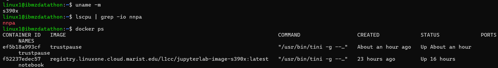
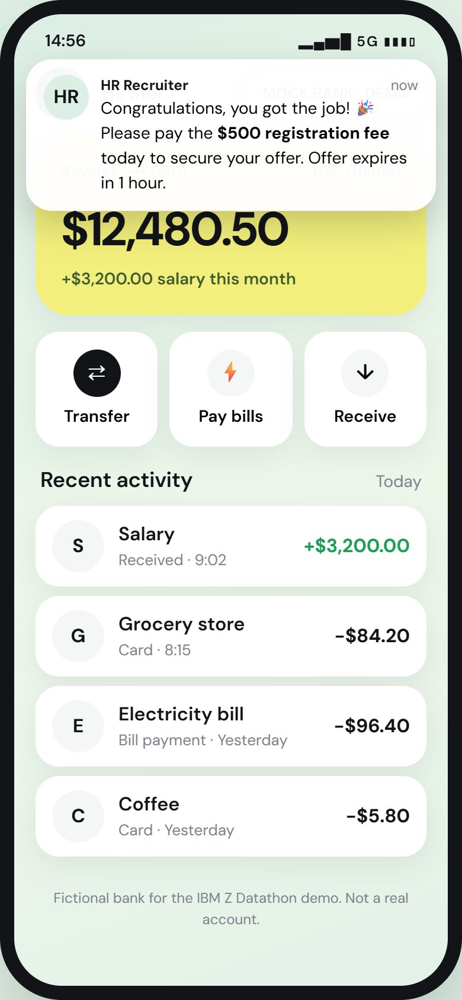
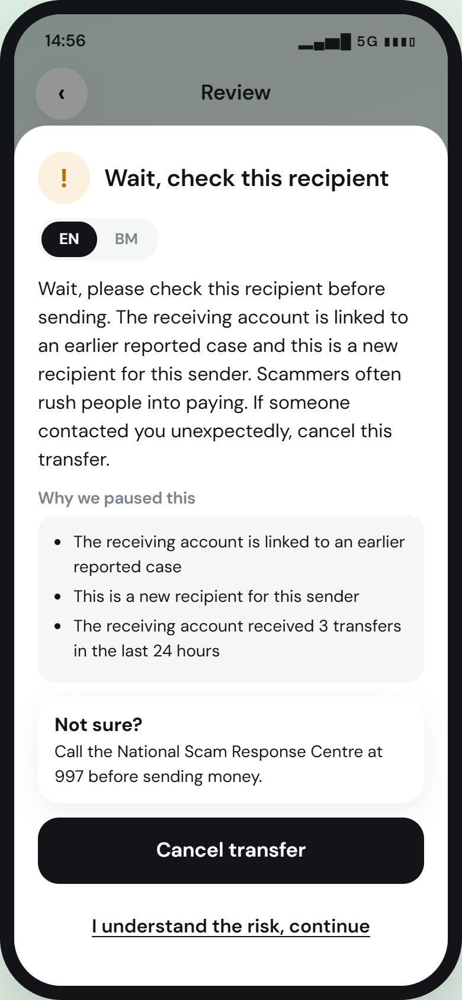
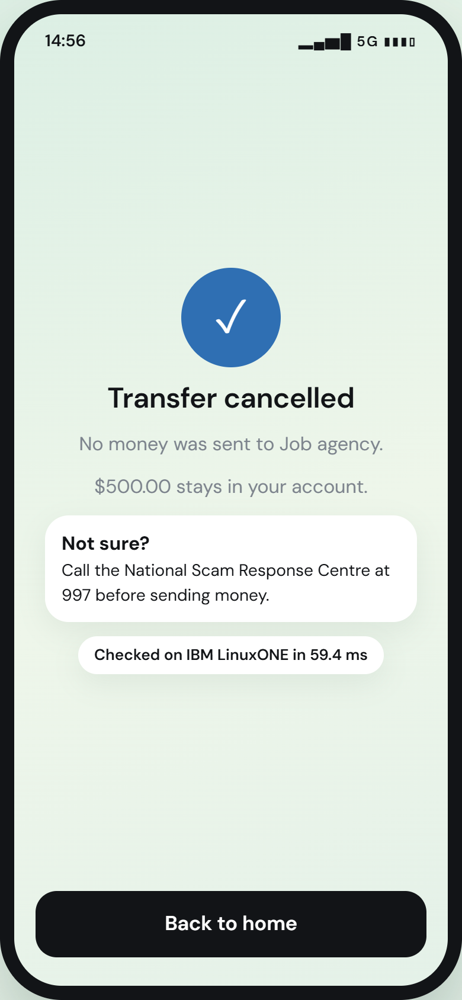
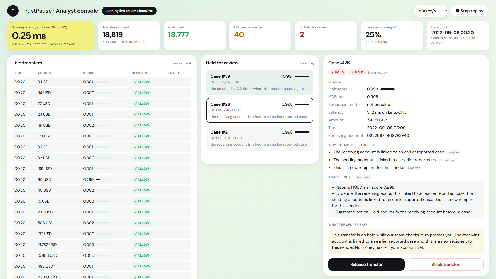

# Stats Power_IBM Z Datathon 2026 Project — TrustPause

**Real-time scam interception on IBM LinuxONE.** TrustPause checks the *receiving* account the moment someone presses Send, and gives them a clear warning before the money leaves. Every decision is made in under a millisecond on IBM LinuxONE, explained in plain language, and backed by a human analyst for the riskiest cases.

- **Theme:** Theme 1, Real-Time AI for Critical Decisions (Detect. Decide. Respond.), under **AI for Good**
- **Platform:** IBM LinuxONE Community Cloud (s390x, Ubuntu 24.04) with the **Telum on-chip AI accelerator (NNPA)**
- **Event code:** SSF2026

---

## The problem

In most scams the **victim sends the money themselves**: a fake job offer, an investment tip, a caller pretending to be the bank. The bank sees a normal transfer from a real customer, so rules on the *sender's* side don't fire. Once the money reaches a mule account it moves on within minutes and is very rarely recovered.

The signal is on the **receiving** side: accounts that suddenly collect money from many unrelated people, accounts that are new to the sender, and accounts linked to earlier reported cases.

**Scams in Malaysia are growing fast, and very little money comes back:**

| Figure | Value | Source |
|---|---|---|
| Online crime losses, Jan–Nov 2025 | **over RM2.7 billion** across **67,735 cases** | Royal Malaysia Police / Bukit Aman CCID, via [The Vibes, 8 Dec 2025](https://www.thevibes.com/articles/news/116658/malaysia-hit-with-over-67000-online-crime-cases-in-11-months-losses-surpass-rm2.7-billion) |
| Scam losses, full year 2024 | **RM1.6 billion** across **35,368 cases** | Bukit Aman CCID director, via [Bernama, 3 Mar 2025](https://bernama.com/en/news.php?id=2398423) |
| Largest loss category, Jan–Nov 2025 | Non-existent investment schemes: **over RM1.37 billion** | [The Vibes, 8 Dec 2025](https://www.thevibes.com/articles/news/116658/malaysia-hit-with-over-67000-online-crime-cases-in-11-months-losses-surpass-rm2.7-billion) |
| Accounts frozen by the National Scam Response Centre (997) in 2025 | **138,915** accounts, from **146,167** complaint calls | Home Minister, via [Asia News Network, 4 Mar 2026](https://asianews.network/?p=260552) |
| Money saved from syndicates in 2025 | **RM34.05 million**; **RM6.65 million** returned to victims (up from RM508,479 in 2024) | Home Minister, via [Asia News Network, 4 Mar 2026](https://asianews.network/?p=260552) |

In 11 months of 2025, reported losses were already **about 70% higher than the whole of 2024**. The amounts saved and returned are a tiny share of what was lost (the figures come from different agencies and periods, so read the comparison as an order of magnitude). Once money leaves the victim's account, it is very hard to get back. TrustPause acts **before** it leaves.

**Who it protects:** ordinary people sending money, especially the elderly, students and first-time digital banking users targeted by job, investment and impersonation scams. **Who uses it:** a bank's fraud analysts, who review held transfers.

## What TrustPause does

1. **Scores every transfer as it happens.** 24 behavioural features about the receiver and sender are computed from rolling 1-hour and 24-hour account state, then an XGBoost model scores the transfer.
2. **Decides in three bands:**

   | Decision | When | What the sender sees |
   |---|---|---|
   | **Allow** | Low risk | Nothing extra; the transfer goes through |
   | **Pause & warn** | Top ~0.5% of risk | A plain-language warning in **English and Bahasa Malaysia** with the reasons and the **997 National Scam Response Centre** hotline; *Cancel transfer* is the default |
   | **Hold** | Top ~0.05% of risk | The transfer waits for a human analyst, who releases or blocks it |

3. **Explains every flag.** Reasons come straight from the model's own feature contributions (XGBoost `pred_contribs`), turned into sentences such as *"the receiving account got money from 23 different senders in the last 24 hours"*. No account IDs appear in any explanation.
4. **Keeps a human in the loop.** Held transfers go to an analyst console with the score, reasons and a case note. **IBM Granite**, running locally on LinuxONE, drafts the analyst note; the warnings shown to customers always use reviewed templates.

## Results (measured on IBM LinuxONE)

Data: IBM's synthetic AML dataset (HI-Small), split **by time**: train Sep 1–6, validation Sep 7–8, **test Sep 9–10** (862,792 transfers, 0.11% laundering). Thresholds were chosen on validation only.

| Metric | Validation | **Test** |
|---|---|---|
| PR-AUC (XGBoost) | 0.361 | **0.254** (about 230× the 0.11% base rate) |
| ROC-AUC | 0.982 | **0.974** |
| **Hold** band: share held · precision · recall | 0.05% · 62% · 29% | **0.049% · 52% · 23%** |
| **Pause** band: share paused · precision · recall | 0.5% · 13% · 62% | **0.70% · 8% · 52%** |

In plain words: on unseen days, TrustPause **holds about 1 in 2,000 transfers and half of those are laundering**, and it **warns on fewer than 1 in 100 transfers while catching over half of all laundering**.

| Speed on LinuxONE | Result |
|---|---|
| Feature computation | **25.8 µs** per transaction (5.08 M transactions in 131 s, one core) |
| XGBoost prediction | p50 **0.10 ms**, p95 0.30 ms |
| **Whole live pipeline** (features + model + reasons) | p50 **0.30 ms**, p95 **0.72 ms** |
| Live scores vs training scores | **Identical** (`python -m src.scorer --verify 2000` → `MATCH`) |

### Running on IBM LinuxONE

The live server: `uname -m` → **s390x** (IBM Z architecture), `lscpu` lists **nnpa** (Telum on-chip AI accelerator), and `docker ps` shows the **trustpause** container up next to the L1CC Jupyter container.



### Telum on-chip AI accelerator (NNPA)

We ran a PyTorch GRU sequence model on the NNPA through `torch_nnpa` (`is_telum2_available()` → `True`; outputs match CPU within 0.00025):

| GRU inference, 1,000 runs | CPU p50 | **NNPA p50** | Speed-up |
|---|---|---|---|
| Batch 1 | 0.171 ms | **0.082 ms** | **2.1×** |
| Batch 64 | 1.693 ms | **0.131 ms** | **12.9×** |

On this dataset the sequence model did not improve accuracy (test PR-AUC 0.005 vs 0.254), and validation chose 100% XGBoost, so **live decisions use XGBoost**. The NNPA result shows the platform headroom for heavier neural models.

### Honest limitations

- The data is **synthetic** (IBM's AML simulator), used as a stand-in for real mule behaviour; real bank data would differ.
- "Real time" is a **replay** of the test days on one server; production would need streaming infrastructure and data from many banks.
- The strongest signals are links to **earlier reported accounts**, which is realistic for a central fraud database but means new mule rings are harder to catch.
- Some legitimate accounts also receive from many people (shops, landlords), so the middle band **warns** rather than blocks, and only the top band is held for a human.
- Payment format is the top feature by gain, a quirk of this dataset.

## Architecture

```
 Replay of test days            Sender view (fictional banking app)
         │                                  │
         ▼                                  ▼
 ┌──────────────── IBM LinuxONE (s390x) ─────────────────────────┐
 │  FastAPI                                                       │
 │   ├─ AccountState: rolling 1h / 24h features (24 per transfer) │
 │   ├─ XGBoost score → Allow / Pause & warn / Hold               │
 │   ├─ Reasons from pred_contribs (no account IDs)               │
 │   ├─ Templates (EN / BM) for the sender's warning              │
 │   ├─ IBM Granite (llama.cpp): analyst notes for held cases     │
 │   └─ SQLite: transactions, cases, analyst decisions            │
 │  PyTorch GRU on Telum NNPA (benchmark)                         │
 └────────────────────────────────────────────────────────────────┘
         │
         ▼
 Analyst console: live feed, held queue, case detail, Release / Block
```

### Privacy and security by design
- Granite runs **on the LinuxONE server**: no transaction data goes to an external AI service.
- Prompts contain only reason codes, counts and amounts. An automatic check confirms **no identifiers** (`screenshots/granite_prompt_privacy.png`).
- Server access is **SSH keys only**; the API and Jupyter listen on localhost and are reached through SSH tunnels (no public ports).
- Granite text is accepted only if it passes format checks, so a bad generation never replaces a reviewed text.

## Demo

- **Sender view** (`/sender`): a fictional mobile bank. A message from an "HR Recruiter" asks for a job registration fee; paying it triggers the TrustPause security check and the warning sheet. Safe recipients go straight through.
- **Analyst console** (`/analyst`): replays the test days at hundreds of transfers per second, with live counts, latency, laundering caught, a queue of held transfers and case detail with Release / Block.

All names, balances and accounts in the demo are fictional.

| The scam message | The warning (live on LinuxONE) | After cancelling |
|---|---|---|
|  |  |  |



## Repository

```
src/
  data.py        load the dataset, drop sparse days, time-based split
  features.py    AccountState: 24 rolling features (same code for training and live scoring)
  train_xgb.py   XGBoost training, thresholds, metrics
  reasons.py     pred_contribs → reason codes and sentences
  train_seq.py   PyTorch GRU + CPU vs NNPA benchmark
  explain.py     IBM Granite via llama.cpp, with privacy checks
  templates.py   EN / BM warning templates
  scorer.py      live scorer + verification against training scores
  stream.py      paced replay of the test days
  db.py          SQLite store
  api.py         FastAPI app and pages
web/             sender.html, analyst.html, style.css
notebooks/       01 explore · 02 features · 03 XGBoost · 04 sequence + NNPA · 05 Granite
models/          trained models and thresholds
screenshots/     evidence (labs, charts, privacy check, Docker on s390x)
Dockerfile, .dockerignore   container build for LinuxONE
work-cards/, *.md   planning files and build log (see build-status.md)
```

## How to run on IBM LinuxONE Community Cloud

Requirements: an L1CC Ubuntu 24.04 server with the L1CC Jupyter Lab ML image (it already includes pandas, scikit-learn, XGBoost, PyTorch, `torch_nnpa` and `llama_cpp_python`). Run these in the Jupyter terminal.

```bash
git clone https://github.com/teohweibin/TrustPause.git ~/shared/trustpause
cd ~/shared/trustpause
pip install -r requirements.txt            # fastapi, uvicorn
# Put HI-Small_Trans.csv (see Dataset) in data/

nohup python -m src.features  > data/features_build.log 2>&1 &   # ~2 min: data/features_all.pkl
nohup python -m src.train_xgb > data/train_xgb.log 2>&1 &        # ~1–2 min: models/xgb.json, thresholds, metrics
python -m src.scorer --verify 2000                               # live scores must print MATCH
python -m src.train_seq                                          # optional: GRU + NNPA benchmark

GRANITE_MODEL_PATH=/path/to/granite.gguf \
  nohup uvicorn src.api:app --host 127.0.0.1 --port 8000 > data/api.log 2>&1 &
curl -s localhost:8000/api/status                                # wait for "stage": "ready" (~2 min)
```

From your laptop, open an SSH tunnel and browse to `http://localhost:8000/sender` and `http://localhost:8000/analyst`:

```bash
ssh -i <your_key>.pem -L 8000:localhost:8000 linux1@<server-ip>
```

### Run in Docker on LinuxONE (card 08)

The image is built **on the LinuxONE host** from the L1CC Jupyter image, so it is `s390x` and already contains the AI libraries (`Dockerfile`). The dataset, models, database, keys and the Granite model are **not** baked into the image (`.dockerignore`); they are mounted at runtime.

```bash
cd ~/shared/trustpause
docker build -t trustpause .
docker run -d --name trustpause --network host   -v ~/shared/trustpause/data:/app/data   -v ~/shared/trustpause/models:/app/models:ro   -v /home/linux1/granite:/granite:ro   -e GRANITE_MODEL_PATH=/granite/granite-4.0-h-350m-base-be.f16.gguf   trustpause
docker ps                                  # container "trustpause" is Up
```

To run a second copy next to an existing API (e.g. for checking), add `python3 -m uvicorn src.api:app --host 127.0.0.1 --port 8001` at the end of `docker run` and give it another `--name`.

**Verified on IBM LinuxONE:** image builds as `s390x`; container starts; warm-up of 4,214,445 historical transactions completes and `/api/status` reports `ready`; `/sender` and `/analyst` return HTTP 200 and open through the SSH tunnel; the Granite model is readable inside the container (`screenshots/docker_s390x_evidence.png`).

## Dataset

**IBM Transactions for Anti Money Laundering (AML)**, file `HI-Small_Trans.csv`: synthetic bank transfers with laundering labels, created by IBM researchers.
- Kaggle: https://www.kaggle.com/datasets/ealtman2019/ibm-transactions-for-anti-money-laundering-aml
- Paper: Altman et al., *Realistic Synthetic Financial Transactions for Anti-Money Laundering Models*, NeurIPS 2023 Datasets and Benchmarks.
- Licence: [Community Data License Agreement – Sharing, Version 1.0 (CDLA-Sharing-1.0)](https://cdla.dev/sharing-1-0/), as listed on Kaggle.

The dataset is not included in this repository (`data/` is git-ignored).

## Open-source software and models used

| Component | Use | Link |
|---|---|---|
| Python | Language | https://www.python.org |
| pandas | Data loading and splits | https://pandas.pydata.org |
| NumPy | Feature arrays | https://numpy.org |
| scikit-learn | Metrics (PR-AUC, ROC-AUC) | https://scikit-learn.org |
| XGBoost | Risk model and `pred_contribs` explanations | https://xgboost.ai |
| PyTorch | GRU sequence model | https://pytorch.org |
| torch_nnpa | PyTorch on the Telum NNPA | Pre-installed in the L1CC Jupyter Lab ML image (https://github.com/linuxone-community-cloud/jupyter-lab-ml) |
| llama.cpp / llama-cpp-python | Local LLM runtime | https://github.com/ggml-org/llama.cpp · https://github.com/abetlen/llama-cpp-python |
| IBM Granite 4.0 H 350M | Analyst notes, run locally (GGUF, `-be` build for s390x) | https://huggingface.co/ibm-granite |
| FastAPI | API | https://fastapi.tiangolo.com |
| Uvicorn | ASGI server | https://www.uvicorn.org |
| Pydantic | Request validation | https://docs.pydantic.dev |
| SQLite | Case store | https://www.sqlite.org |
| DM Sans | UI font (Google Fonts) | https://fonts.google.com/specimen/DM+Sans |
| Docker | s390x container on LinuxONE | https://www.docker.com |

All TrustPause code was written during the IBM Z Datathon (Oct 17–18, 2026). The two IBM reference labs (`Fraud_LSTM_Keras_TF.ipynb`, `Loan_Approval_Demo.ipynb`) were run to learn the platform (`screenshots/labs/`); no lab code is reused.
